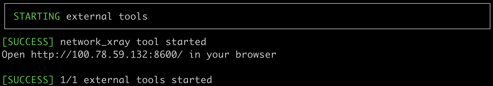
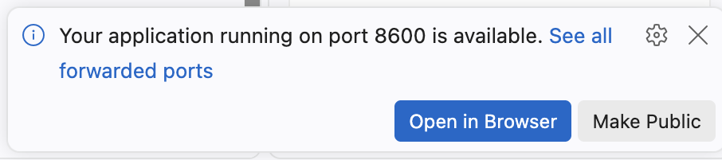

# Additional Tools

_netlab_ can start [additional tools](https://netlab.tools/extools/) after starting the lab topology. For example, you could:

* Use [Graphite GUI](https://netlab.tools/extool/graphite/) to display lab topology and connect to lab devices via SSH[^NOSSH]
* Capture traffic between nodes in your lab with [Edgeshark](https://netlab.tools/extool/edgeshark/)
* Visualize the BGP tables on lab devices[^XRL] with the [network-xray tool](https://github.com/rclab-dev/network-xray)
* Observe the changes in your network with [SuzieQ](https://netlab.tools/extool/suzieq/)[^SQL]

[^NOSSH]: You cannot use the Graphite GUI to connect to lab devices that do not run an SSH server, for example, FRRouting or VyOS containers.

[^XRL]: Currently, the network-xray tool works with FRRouting and SR Linux containers.

[^SQL]: SuzieQ uses SSH to connect to lab devices. It does not work with FRRouting or VyOS containers.

The easiest way to start additional tools without modifying the lab topologies is via [environment variables](https://netlab.tools/extools/#enabling-tools-in-user-defaults). Set these environment variables to True to enable the above-mentioned tools:

| To enable... | ... set this variable |
|--------------|-----------------------|
| Graphite GUI | NETLAB_TOOLS_GRAPHITE_ENABLED |
| Edgeshark | NETLAB_TOOLS_EDGESHARK_ENABLED |
| network-xray | NETLAB_TOOLS_NETWORK__XRAY_ENABLED |
| SuzieQ | NETLAB_TOOLS_SUZIEQ_ENABLED |

For example, to enable the Graphite GUI, use:

```bash
$ export NETLAB_TOOLS_GRAPHITE_ENABLED=True
```

Use the **unset** command to remove an environment variable, for example:

```bash
$ unset NETLAB_TOOLS_GRAPHITE_ENABLED
```

The **netlab up** command starts the additional tools automatically after it sets up the lab topology. It also prints brief instructions for using the tools, such as the URL needed to access them:

[](img/tool-start.png)

!!! Tip
    **netlab up** and **netlab connect** commands use SSH environment variables to determine the IP address displayed in the URL. If you don't use SSH to connect to the Linux server, the URL starts with `http://127.0.0.1/`

When you start an external tool within a [GitHub Codespace](4-codespaces.md), you'll get a pop-up notification within your browser. Click on the **Open in Browser** button to connect to the tool in a separate browser tab.

[](img/codespaces-port.png)

Alternatively, you could click on the **Ports** tab in the **Terminal** part of your Codespace page to display the application (tool) ports and connect to them.
