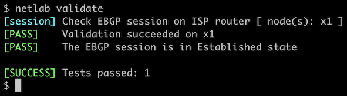

# Configure a Single EBGP Session

We'll start with the simplest possible scenario: configure an EBGP session between your device and an upstream router (X1).

**Note:** If you're [creating your lab infrastructure manually](../external/index.md), it might be better to skip this exercise and go straight to *[configuring two uplinks](2-multihomed.md)*.


## Device Requirements {#req}

* Use any device [supported by the _netlab_ BGP configuration module](https://netlab.tools/platforms/#platform-routing-support) for customer and external routers.
* _netlab_ can configure [default route origination](https://netlab.tools/plugins/bgp.session/#platform-support) on almost all supported devices. You'll have to configure BGP default route origination yourself if you want to use an unsupported device for X1.
* You can do automated lab validation with Arista EOS or FRRouting running on X1.

## Start the Lab

You can start the lab [on your own lab infrastructure](../1-setup.md) or in [GitHub Codespaces](https://github.com/codespaces/new/bgplab/bgplab) ([more details](../4-codespaces.md)):

* Change directory to `basic/1-session`
* (Optional) enable the [extra tools you want to use](../5-tools.md)
* Execute **netlab up**
* Log into your device (RTR) with **netlab connect rtr** and verify that the IP addresses are configured on all its interfaces.

## Configuration Tasks

* Start BGP routing process with AS number 65000
* Configure an EBGP session using the following parameters:

| neighbor IP address | neighbor AS number |
|--------------------:|-------------------:|
| 10.1.0.2            | 65100              |

!!! Tip
    * If you're using an FRRouting virtual machine for RTR, you might have to enable the BGP daemon first. You'll find more details in the [Configuring FRRouting](0-frrouting.md) lab.
    * Not sure how to configure BGP on your device? You'll find pointers to the relevant vendor documentation in the [Further Reading](#further) section.

!!! Warning
    If your device happens to be [fully compliant with RFC 8212](https://blog.ipspace.net/2023/06/default-ebgp-policy-rfc-8212.html) (example: Cisco IOS XR), you'll have to configure a *permit everything* incoming filter on the EBGP session or your device won't accept updates from its EBGP neighbor(s).

On some devices, you'll also have to **activate** the EBGP session within the IPv4 **address family** to tell the BGP daemon on your router to accept IPv4 prefixes from its neighbor.

Finally, it's always a good idea to configure:

* Neighbor description to simplify troubleshooting and
* BGP neighbor status logging to get an information message when the BGP session is established.

## Verification

You can use the **netlab validate** command if you use FRRouting or Arista EOS on the external router.



If that command fails or you're using another network operating system on the external routers, it's time to start a troubleshooting session.

Check the state of the BGP session with a command similar to **show ip bgp summary**. This is a printout taken from Arista EOS:

```
rtr#show ip bgp summary
BGP summary information for VRF default
Router identifier 10.0.0.1, local AS number 65000
Neighbor Status Codes: m - Under maintenance
  Neighbor V AS           MsgRcvd   MsgSent  InQ OutQ  Up/Down State   PfxRcd PfxAcc
  10.1.0.2 4 65100             33        37    0    0 00:01:25 Estab   2      2
```

Finally, use a command similar to **show ip bgp** to verify that your router received two prefixes from the EBGP neighbor: the default route and the loopback remote interface (10.0.0.10/32). This is what the printout looks like on Arista EOS:

```
rtr#show ip bgp
BGP routing table information for VRF default
Router identifier 10.0.0.1, local AS number 65000
Route status codes: s - suppressed contributor, * - valid, > - active, E - ECMP head, e - ECMP
                    S - Stale, c - Contributing to ECMP, b - backup, L - labeled-unicast
                    % - Pending BGP convergence
Origin codes: i - IGP, e - EGP, ? - incomplete
RPKI Origin Validation codes: V - valid, I - invalid, U - unknown
AS Path Attributes: Or-ID - Originator ID, C-LST - Cluster List, LL Nexthop - Link Local Nexthop

          Network                Next Hop              Metric  AIGP       LocPref Weight  Path
 * >      0.0.0.0/0              10.1.0.2              0       -          100     0       65100 i
 * >      10.0.0.10/32           10.1.0.2              0       -          100     0       65100 i
```

**Next:**

* [Connect with the second upstream provider](2-multihomed.md) and advertise your address space.

## Further Reading {#further}

The following documents describe how to start a BGP routing process and configure EBGP neighbors on commonly used network devices. FRRouting and Cisco IOS XR also require EBGP routing policies by default.

| Platform | Configuration guidelines |
|----------|--------------------------|
| Cisco IOS XE | <ul><li>[Configure a BGP routing process](https://www.cisco.com/c/en/us/td/docs/routers/ios/config/17-x/ip-routing/b-ip-routing/m_irg-basic-net-0.html#:~:text=Perform%20this%20task%20to%20configure%20a%20BGP%20routing%20process)</li><li>[Configure a BGP peer](https://www.cisco.com/c/en/us/td/docs/routers/ios/config/17-x/ip-routing/b-ip-routing/m_irg-basic-net-0.html#:~:text=Perform%20this%20task%20to%20configure%20BGP%20between%20two%20IPv4%20routers%20%28peers%29)</li></ul> |
| Arista EOS | <ul><li>[Configure a BGP instance](https://www.arista.com/en/um-eos/eos-border-gateway-protocol-bgp#:~:text=Creating%20an%20Instance%20and%20Entering%20BGP%20Configuration%20Mode)</li><li>[Establish BGP neighbors](https://www.arista.com/en/um-eos/eos-border-gateway-protocol-bgp#:~:text=Establishing%20BGP%20Neighbors)</li></ul> |
| FRRouting | <ul><li>[Start a BGP process](https://docs.frrouting.org/en/latest/bgp.html#:~:text=Enable%20a%20BGP%20protocol%20process%20with%20the%20specified%20ASN)</li><li>[Define a BGP peer](https://docs.frrouting.org/en/latest/bgp.html#:~:text=Creates%20a%20new%20neighbor%20whose%20remote%2Das%20is%20ASN)</li><li>[EBGP policy requirements](https://docs.frrouting.org/en/latest/bgp.html#:~:text=This%20command%20requires%20incoming%20and%20outgoing%20filters%20to%20be%20applied)</li></ul> |
| Cisco IOS XR (release 26.x) | <ul><li>[Enable BGP routing](https://www.cisco.com/c/en/us/td/docs/iosxr/ncs5500/bgp/26xx/configuration/guide/b-bgp-cg-ncs5500-26xx/implementing-bgp.html#:~:text=Perform%20this%20task%20to%20enable%20BGP%20routing%20and%20establish%20a%20BGP%20routing%20process)</li><li>[Configure a BGP neighbor](https://www.cisco.com/c/en/us/td/docs/iosxr/ncs5500/bgp/26xx/configuration/guide/b-bgp-cg-ncs5500-26xx/implementing-bgp.html#:~:text=configures%20the%20neighbor%20IP%20address%20as%20a%20BGP%20peer)</li><li>[EBGP policy requirements](https://www.cisco.com/c/en/us/td/docs/iosxr/ncs5500/bgp/26xx/configuration/guide/b-bgp-cg-ncs5500-26xx/implementing-bgp.html#:~:text=you%20must%20configure%20an%20inbound%20and%20outbound%20route%20policy%20on%20the%20neighbor)</li></ul> |
| Junos | <ul><li>[Set the autonomous system number](https://www.juniper.net/documentation/us/en/software/junos/bgp/topics/topic-map/bgp-peering-sessions.html#:~:text=Set%20the%20autonomous%20system%20%28AS%29%20number)</li><li>[Configure EBGP neighbors](https://www.juniper.net/documentation/us/en/software/junos/bgp/topics/topic-map/bgp-peering-sessions.html#id-example-configuring-external-bgp-point-to-point-peer-sessions)</li></ul> |

## Reference Information

This lab uses a subset of the [4-router lab topology](../external/4-router.md). The following information might help you if you plan to build custom lab infrastructure:

### Lab Wiring

| Origin Device | Origin Port | Destination Device | Destination Port |
|---------------|-------------|--------------------|------------------|
| rtr | Ethernet1 | x1 | eth1 |

### Lab Addressing

| Node/Interface | IPv4 Address | IPv6 Address | Description |
|----------------|-------------:|-------------:|-------------|
| **rtr** |  10.0.0.1/32 |  | Loopback |
| Ethernet1 | 10.1.0.1/30 |  | rtr -> x1 |
| **x1** |  10.0.0.10/32 |  | Loopback |
| eth1 | 10.1.0.2/30 |  | x1 -> rtr |
