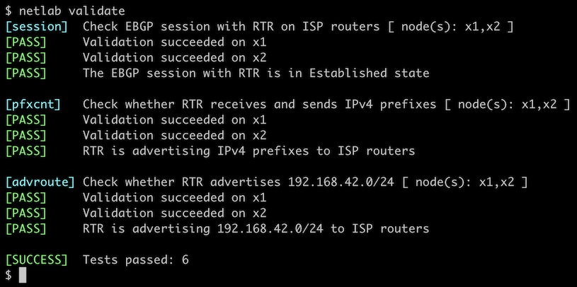

# Advertise IPv4 Prefixes to BGP Neighbors

In the [previous lab exercise](2-multihomed.md), you configured EBGP sessions with two routers belonging to upstream ISPs. Now it's time to advertise your address space (IPv4 prefixes) to them so you'll start receiving some traffic.


The routers in your lab use the following BGP AS numbers. Each upstream router advertises an IPv4 prefix and the default route.

| Node/ASN | Router ID | Advertised prefixes |
|----------|----------:|--------------------:|
| **AS65000** ||
| rtr | 10.0.0.1 | |
| **AS65100** ||
| x1 | 10.0.0.10 | 192.168.100.0/24 |
| **AS65101** ||
| x2 | 10.0.0.11 | 192.168.101.0/24 |

Your router has these EBGP neighbors. _netlab_ configures them automatically; if you're using some other lab infrastructure, you'll have to configure them manually.

| Node | Neighbor | Neighbor IPv4 | Neighbor AS |
|------|----------|--------------:|------------:|
| rtr | x1 | 10.1.0.2 | 65100 |
| rtr | x2 | 10.1.0.6 | 65101 |

## Device Requirements {#req}

* Use any device [supported by the _netlab_ BGP configuration module](https://netlab.tools/platforms/#platform-routing-support) for customer and external routers.
* _netlab_ can configure [default route origination](https://netlab.tools/plugins/bgp.session/#platform-support) on almost all supported devices. You'll have to configure BGP default route origination yourself if you want to use an unsupported device for X1 or X2.
* You can do automated lab validation with Arista EOS or FRRouting running on X1 and X2.

## Start the Lab

You can start the lab [on your own lab infrastructure](../1-setup.md) or in [GitHub Codespaces](https://github.com/codespaces/new/bgplab/bgplab) ([more details](../4-codespaces.md)):

* Change directory to `basic/3-originate`
* (Optional) enable the [extra tools you want to use](../5-tools.md)
* Execute **netlab up**
* Log into your device (RTR) with **netlab connect rtr** and verify IP addresses and basic BGP configuration.

**Note:** *netlab* will configure IP addresses, start the BGP routing daemon, and configure EBGP sessions on your router. If you're not using *netlab*, continue with the configuration you made during the [previous exercise](2-multihomed.md).

## Configuration Tasks

You have to advertise `192.168.42.0/24` -- the IP address space belonging to your organization -- to the upstream providers.

BGP never originates IP prefixes without being told to do so. The usual ways to do that are:

1. Redistribution of other routing information sources into BGP -- for example, redistributing directly connected subnets or OSPF routes. You'll practice that in the [Redistribute IGP Information Into BGP](5-redistribute.md) lab exercise.
2. Origination of configured prefixes, often using **network** router configuration command. This approach assumes *there's an exact match in the IP routing table*

While the first method is usually used within enterprise networks that use BGP as an internal routing protocol or to connect to an MPLS/VPN service, you should have tight control over the prefixes advertised to the public Internet. Please use the second method in this lab exercise.

Yet again, there are several ways to add an IP prefix that exactly matches the prefix specified in the **network** command to the IP routing table:

* Create a new loopback interface and configure an IP address from the desired prefix on the loopback interface. For example, configure the IP address `192.168.42.1/24` on the `Loopback1` interface.
* Add an IP address from the desired prefix as a secondary IP address on an existing loopback interface[^NPE]. For example, configure the IP address `192.168.42.1/24` as a secondary IP address on the `Loopback0` interface.
* Add a static route pointing to nowhere for the desired IP prefix. For example, add the static route for `192.168.42.0/24` pointing to the `null0` interface. Try using this approach in this lab exercise.
 
[^NPE]: It's a bad idea to add the secondary IP address to a physical interface just to have it in the IP routing table. A physical interface failure would remove the IP prefix from the IP routing table and cause the BGP router to revoke the BGP advertisement.

!!! Warning
    If your device happens to be [fully compliant with RFC 8212](https://blog.ipspace.net/2023/06/default-ebgp-policy-rfc-8212.html) (example: Cisco IOS XR), you'll have to configure a *permit everything* outgoing filter on all EBGP neighbors or your device won't send them anything.

!!! Tip
    Not sure how to configure static routes or advertise IPv4 prefixes on your device? You'll find pointers to the relevant vendor documentation in the [Further Reading](#further) section.

## Verification

You can use the **netlab validate** command if you use FRRouting or Arista EOS on the external routers.



If that command fails or you're using another network operating system on the external routers, it's time to start a troubleshooting session.

The IPv4 prefixes you want to advertise to EBGP neighbors must be in your router's BGP table first. A command similar to **show ip bgp** is thus a good starting point. This is how Arista EOS displays the BGP table:

```
rtr#show ip bgp
BGP routing table information for VRF default
Router identifier 10.0.0.1, local AS number 65000
Route status codes: s - suppressed contributor, * - valid, > - active, E - ECMP head, e - ECMP
                    S - Stale, c - Contributing to ECMP, b - backup, L - labeled-unicast
                    % - Pending BGP convergence
Origin codes: i - IGP, e - EGP, ? - incomplete
RPKI Origin Validation codes: V - valid, I - invalid, U - unknown
AS Path Attributes: Or-ID - Originator ID, C-LST - Cluster List, LL Nexthop - Link Local Nexthop

          Network                Next Hop              Metric  AIGP       LocPref Weight  Path
 * >      0.0.0.0/0              10.1.0.2              0       -          100     0       65100 i
 *        0.0.0.0/0              10.1.0.6              0       -          100     0       65101 i
 * >      192.168.42.0/24        -                     -       -          -       0       ?
 * >      192.168.100.0/24       10.1.0.2              0       -          100     0       65100 i
 * >      192.168.101.0/24       10.1.0.6              0       -          100     0       65101 i
```

However, you must know if your router advertises its prefixes to its EBGP neighbors. Some network devices have a **show** command that displays prefixes advertised to a neighbor. Here's how that command works on Arista EOS:

```
rtr#show ip bgp neighbor 10.1.0.2 advertised-routes
BGP routing table information for VRF default
Router identifier 10.0.0.1, local AS number 65000
Route status codes: s - suppressed contributor, * - valid, > - active, E - ECMP head, e - ECMP
                    S - Stale, c - Contributing to ECMP, b - backup, L - labeled-unicast, q - Queued for advertisement
                    % - Pending BGP convergence
Origin codes: i - IGP, e - EGP, ? - incomplete
RPKI Origin Validation codes: V - valid, I - invalid, U - unknown
AS Path Attributes: Or-ID - Originator ID, C-LST - Cluster List, LL Nexthop - Link Local Nexthop

          Network                Next Hop              Metric  AIGP       LocPref Weight  Path
 * >      192.168.42.0/24        10.1.0.1              -       -          -       -       65000 ?
 * >      192.168.101.0/24       10.1.0.1              -       -          -       -       65000 65101 i
```

Check the BGP table on the remote router to ensure everything is okay. While that's a bit hard to do in real life (unless your ISP offers a [looking glass](https://en.wikipedia.org/wiki/Looking_Glass_server)), it's way more manageable in a lab -- connect to X1 or X2 with **netlab connect** (or SSH into them if you're not using _netlab_), start `vtysh` if you're running FRRouting on them, and execute the **show ip bgp** command:

```
$ netlab connect x1
Connecting to container clab-originate-x1, starting bash
Use vtysh to connect to FRRouting daemon

x1(bash)#sudo vtysh

Hello, this is FRRouting (version 9.0.1_git).
Copyright 1996-2005 Kunihiro Ishiguro, et al.

x1# show ip bgp
BGP table version is 5, local router ID is 192.168.100.1, vrf id 0
Default local pref 100, local AS 65100
Status codes:  s suppressed, d damped, h history, * valid, > best, = multipath,
               i internal, r RIB-failure, S Stale, R Removed
Nexthop codes: @NNN nexthop's vrf id, < announce-nh-self
Origin codes:  i - IGP, e - EGP, ? - incomplete
RPKI validation codes: V valid, I invalid, N Not found

    Network          Next Hop            Metric LocPrf Weight Path
 *> 192.168.42.0/24  10.1.0.1                               0 65000 ?
 *> 192.168.100.0/24 0.0.0.0(x1)              0         32768 i
 *> 192.168.101.0/24 10.1.0.1                               0 65000 65101 i

Displayed  3 routes and 3 total paths
```

**Next:**

* If you're interested in BGP routing policies, proceed to [Use BGP Weights](../policy/1-weights.md) to prefer one of the upstream ISPs.
* If you want to build networks with more than one BGP router, continue with [Running BGP in Larger Networks](../ibgp/1-edge.md)

You could also do these optional exercises:

* [Configure BGP for IPv6](4-ipv6.md)
* [Redistribute IGP Information Into BGP](5-redistribute.md)
* [Protect EBGP sessions](6-protect.md)
* [Use BFD to Speed Up BGP Convergence](7-bfd.md)
* [BGP route aggregation](8-aggregate.md)

## Further Reading {#further}

The following documents describe how to configure a static route pointing to the null interface and how to advertise an IPv4 prefix to BGP neighbors on commonly used network devices. Junos does not have a **network** command; you have to use a BGP export policy instead. Juniper documentation does not have a simple example of that, so we're pointing you to a blog post that explains it step-by-step.

You'll find the documentation describing how to configure EBGP neighbors and the default EBGP policy (FRRouting and Cisco IOS XR) in the [Further Reading](1-session.md#further) section of the *[Configure a Single EBGP Session](1-session.md)* lab exercise.

| Platform | Configuration guidelines |
|----------|--------------------------|
| Cisco IOS XE | <ul><li>[Configure a static route](https://www.cisco.com/c/en/us/td/docs/routers/ios/config/17-x/ip-routing/b-ip-routing/m_iri-iprouting.html#:~:text=To%20configure%20a%20static%20route%2C%20use%20the%20ip%20route%20prefix%20mask)</li><li>[Advertise a prefix with the network command](https://www.cisco.com/c/en/us/td/docs/routers/ios/config/17-x/ip-routing/b-ip-routing/m_irg-basic-net-0.html#:~:text=For%20exterior%20protocols%2C%20the%20network%20command%20controls%20which%20networks%20are%20advertised)</li></ul> |
| Arista EOS | <ul><li>[Configure a static route](https://www.arista.com/en/um-eos/eos-ipv4#:~:text=switch%28config%29%23ip%20route%20172.17.252.0%2F24%20vlan%20500)</li><li>[Advertise a prefix with the network command](https://www.arista.com/en/um-eos/eos-border-gateway-protocol-bgp#:~:text=Network%20Route%20Advertising%20in%20Address%20Families)</li></ul> |
| FRRouting | <ul><li>[Configure a blackhole static route](https://docs.frrouting.org/en/latest/static.html#:~:text=Alternatively%2C%20the%20gateway%20can%20be%20specified%20as%20Null0%20or%20blackhole%20to%20create%20a%20blackhole%20route)</li><li>[Advertise a prefix with the network command](https://docs.frrouting.org/en/latest/bgp.html#:~:text=This%20command%20adds%20the%20announcement%20network)</li></ul> |
| Cisco IOS XR (release 26.x) | <ul><li>[Configure a static route](https://www.cisco.com/c/en/us/td/docs/iosxr/ncs5500/routing/26xx/configuration/guide/b-routing-cg-ncs5500-26xx/implementing-static-routes.html#:~:text=Static%20routes%20are%20entirely%20user%20configurable%20and%20can%20point%20to%20a%20next%2Dhop%20interface%2C%20next%2Dhop%20IP%20address%2C%20or%20both)</li><li>[Advertise a prefix with the network command](https://www.cisco.com/c/en/us/td/docs/iosxr/ncs5500/bgp/26xx/configuration/guide/b-bgp-cg-ncs5500-26xx/implementing-bgp.html#:~:text=network%20172.16.0.0%20255.255.0.0)</li></ul> |
| Junos | <ul><li>[Configure a static route](https://networkingdocs.hpe.com/documentation/us/en/software/junos/static-routing/topics/topic-map/config_static-routes.html)</li><li>[Advertise a static route with a BGP export policy](https://www.networkcuriosity.com/junos-basic-bgp-configuration/#:~:text=Advertising%20A%20Default%20Route%20Into%20BGP) (blog post; use your prefix instead of the default route and apply the export policy to the EBGP neighbors).</li></ul> |

You might also find this blog post useful:

* [Advertising Public IP Prefixes into the Internet](https://blog.ipspace.net/2008/01/bgp-essentials-advertising-public-ip/) explains why you should combine the **network** command with a static route to the null interface when advertising your address space to upstream ISPs.

## Reference Information

This lab uses a subset of the [4-router lab topology](../external/4-router.md). The following information might help you if you plan to build custom lab infrastructure:

### Lab Wiring

| Origin Device | Origin Port | Destination Device | Destination Port |
|---------------|-------------|--------------------|------------------|
| rtr | Ethernet1 | x1 | eth1 |
| rtr | Ethernet2 | x2 | eth1 |

### Lab Addressing

| Node/Interface | IPv4 Address | IPv6 Address | Description |
|----------------|-------------:|-------------:|-------------|
| **rtr** |  10.0.0.1/32 |  | Loopback |
| Ethernet1 | 10.1.0.1/30 |  | rtr -> x1 |
| Ethernet2 | 10.1.0.5/30 |  | rtr -> x2 |
| **x1** |  192.168.100.1/24 |  | Loopback |
| eth1 | 10.1.0.2/30 |  | x1 -> rtr |
| **x2** |  192.168.101.1/24 |  | Loopback |
| eth1 | 10.1.0.6/30 |  | x2 -> rtr |
